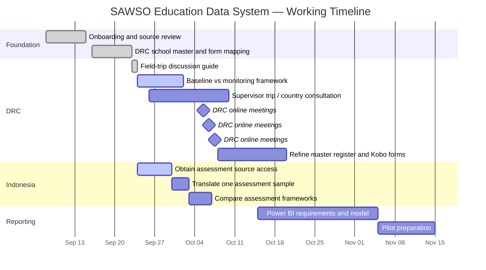

# SAWSO Education Data System

Project tracking, KoboToolbox form design, M&E framework, and reporting documentation for the SAWSO education data systems project.

> **Working repository.** DRC and Indonesia are treated as separate country workstreams. This repository is for project documentation, form design, and tracking. Sensitive learner, safeguarding, salary, or other personally identifiable data should not be stored here.

## Project status

| Workstream | Current phase | Status | Immediate next step |
|---|---|---|---|
| **DRC** | Baseline definition and Kobo form design | 🟡 Active | Finalize baseline vs. ongoing monitoring framework and prepare for supervisor / DRC consultations |
| **Indonesia** | Assessment review and existing-system review | 🟡 Waiting on source access | Obtain one completed school assessment workbook, translate a sample, and compare assessment categories |
| **Power BI / Reporting** | Requirements definition | ⚪ Later phase | Confirm decision needs and reporting hierarchy before dashboard build |

## Current priorities

### DRC
- Finalize the field-trip discussion guide for the DRC visit.
- Separate **Master School Register**, **Baseline School Profile**, **School Assessment**, and **Monthly Monitoring** as distinct instruments.
- Build a source-grounded framework showing what should be collected once, annually / termly, monthly, or only when something changes.
- Confirm whether the existing nine-criterion school assessment rubric in the February workbook is intended as the starting point for DRC.
- Refine the DRC Baseline School Profile XLSForm after country-team feedback.

### Indonesia
- Obtain access to one of the completed school assessment workbooks.
- Translate one sample while preserving official school and place names.
- Verify the reported **11 assessment categories** from the source file.
- Review the qualitative second tab and compare the Indonesia assessment with the DRC nine-criterion rubric.

## DRC: key items waiting on confirmation

- Correct active school total: **615, 617, or another number**.
- Official school-to-office mapping.
- Correct number of managing offices: **13 or 14**.
- Official controlled lists for education and Salvation Army reporting hierarchies.
- Duplicate CONA ID **KSS025**.
- Missing SECOPE IDs and school locations in the source register.
- Whether school level should use three values or four, including **Basic Education**.
- Definitions of current reporting abbreviations and categories.
- Intended status and provenance of the nine-criterion assessment rubric.
- Whether the paper approval chain should be reproduced digitally or replaced by one submission with higher-level review.

## Instrument architecture

| Instrument | Main question it answers | Expected cadence |
|---|---|---|
| **Master School Register** | What school is this and where does it report? | Maintained centrally; update on change |
| **Baseline School Profile** | What does the school have and what is its current situation? | Once, then update major changes |
| **School Assessment** | How is the school performing against agreed criteria? | Periodic |
| **Monthly Monitoring** | What important things have changed since the last report? | Monthly |
| **Annual / Term Reporting** | What official education results and totals are required? | Termly / annual |

## Current project timeline



## Recent outputs

- DRC school master review and data-quality findings.
- DRC annual forms structure mapping.
- English translations of the DRC source workbooks.
- Start-of-Year DRC Kobo XLSForm.
- DRC data-system concept note and field-trip discussion materials.
- DRC Baseline School Profile XLSForm v0.1.
- Indonesia school master review.
- Project work log and open-question tracking.

## Repository structure

```text
.
├── README.md
├── planning/
│   ├── work-log.md
│   ├── open-questions.md
│   └── timeline.md
├── docs/
│   ├── DRC/
│   └── Indonesia/
├── forms/
│   ├── DRC/
│   └── Indonesia/
└── reporting/
    └── power-bi/
```

## Working principles

- Keep **DRC and Indonesia separate**.
- Use the official country source files as the evidence base.
- Do not guess unresolved values; mark them for confirmation.
- Preserve official school names, place names, and codes.
- Design backwards from the decisions and reports the system must support.
- Keep field collection manageable for offline Android / Kobo use.
- Distinguish existing reporting requirements from new M&E recommendations.
- Do not upload sensitive operational data to this repository without explicit approval.
