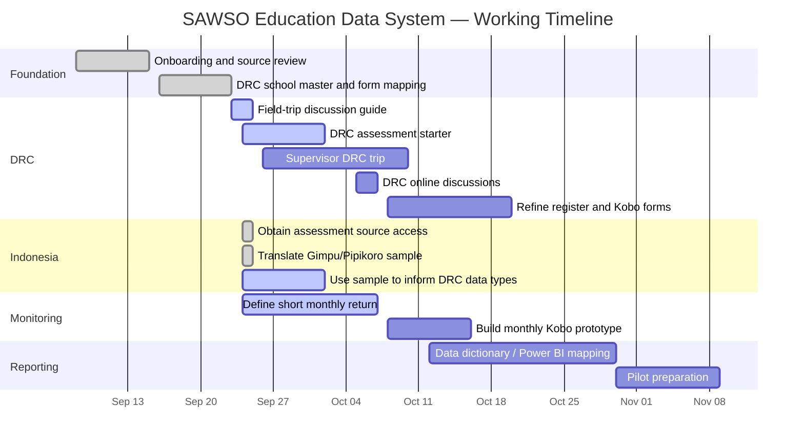

# SAWSO Education Data System

Project tracking, KoboToolbox form design, M&E framework, and reporting documentation for the SAWSO education data systems project.

> **Working repository.** DRC and Indonesia are treated as separate country workstreams. This repository is for project documentation, form design, and tracking. Sensitive learner, safeguarding, salary, or other personally identifiable data should not be stored here.

## Task view

For the Asana-style working view, see **[planning/task-board.md](planning/task-board.md)**. Each active item also has its own GitHub Issue.

### Doing now
- [Finalize concise DRC trip discussion guide](https://github.com/chipojaya1/sawso-education-data-system/issues/1)
- [Refine DRC School Assessment Kobo starter](https://github.com/chipojaya1/sawso-education-data-system/issues/2)
- [Prepare DRC consultations for October 5-7](https://github.com/chipojaya1/sawso-education-data-system/issues/3)

### Waiting
- [Confirm approved DRC school list and active school count](https://github.com/chipojaya1/sawso-education-data-system/issues/4)
- [Obtain school-to-office mapping and official hierarchy lists](https://github.com/chipojaya1/sawso-education-data-system/issues/5)
- [Confirm DRC school-assessment scoring adaptations](https://github.com/chipojaya1/sawso-education-data-system/issues/6)

### Next
- [Build short monthly monitoring Kobo form v0.1](https://github.com/chipojaya1/sawso-education-data-system/issues/7)
- [Build data dictionary and Power BI field mapping](https://github.com/chipojaya1/sawso-education-data-system/issues/8)
- [Resolve DRC master-register defects](https://github.com/chipojaya1/sawso-education-data-system/issues/9)

## Project status

| Workstream | Current phase | Status | Immediate next step |
|---|---|---|---|
| **DRC** | Kobo assessment prototype + consultation preparation | 🟡 Active | Use Doug/DRC feedback to refine the assessment, master register, and monitoring scope |
| **Indonesia** | Assessment review complete for one sample | 🟢 Sample translated | Use the Gimpu/Pipikoro sample as the reference; review remaining reports only if needed |
| **Monthly Monitoring** | Concept definition | 🟡 Draft | Keep proposed monthly return short and decision-focused |
| **Power BI / Reporting** | Requirements definition | ⚪ Later phase | Confirm decision needs and reporting hierarchy before dashboard build |

## Current priorities

### DRC
- Finalize a concise field-trip discussion guide.
- Keep **Master School Register**, **Baseline School Profile**, **School Assessment**, and **Monthly Monitoring** as distinct instruments.
- Refine the starter DRC school-assessment XLSForm without treating unresolved scoring bands as final.
- Prepare for DRC staff discussions on **5-7 October**.
- Obtain the approved school-to-office mapping and official hierarchy lists.

### Indonesia
- Use **Gimpu / Pipikoro** as the translated reference sample.
- Preserve the original school names, scores, formulas, and institutional terminology.
- Use the qualitative evidence tab to inform data types, not to copy Indonesian standards blindly into DRC.

## Simple collection model

| Layer | Purpose | Working approach |
|---|---|---|
| **Baseline** | Stable facts about the school | Collect once; update when something changes |
| **Existing annual / termly** | Current DRC reporting obligations | Preserve the existing reporting cycle |
| **Proposed monthly** | Fast-changing signals that may require action | Keep to a short, roughly five-minute return |

Initial monthly candidates: student attendance; enrolment movement; teacher presence/class coverage; serious facility or WASH problem; priority support/disruption.

## DRC: key items waiting on confirmation

- Correct active school total: **615, 617, or another number**.
- Official school-to-office mapping.
- Correct number of managing offices: **13 or 14**.
- Official controlled lists for education and Salvation Army reporting hierarchies.
- Duplicate CONA ID **KSS025**.
- Missing SECOPE IDs and school locations in the source register.
- Whether school level should use three values or four, including **Basic Education**.
- Definitions of current reporting abbreviations and categories.
- Intended status and provenance of the February assessment rubric.
- DRC-specific definitions for assessment criteria that cannot be inherited from Indonesia.

## Instrument architecture

| Instrument | Main question it answers | Expected cadence |
|---|---|---|
| **Master School Register** | What school is this and where does it report? | Maintained centrally; update on change |
| **Baseline School Profile** | What does the school have and what is its current situation? | Once, then update major changes |
| **School Assessment** | How is the school performing against agreed criteria? | Periodic |
| **Monthly Monitoring** | What important things have changed since the last report? | Monthly |
| **Annual / Term Reporting** | What official education results and totals are required? | Termly / annual |

## Current project timeline



## Recent outputs

- English Gimpu / Pipikoro Indonesia school-assessment sample.
- DRC school master review and data-quality findings.
- DRC annual forms structure mapping.
- English translations of the DRC source workbooks.
- Start-of-Year DRC Kobo XLSForm.
- DRC Baseline School Profile XLSForm v0.1.
- DRC School Assessment Kobo starter with the 615-school master list.
- Baseline vs. annual/termly vs. monthly monitoring framework.
- DRC field-trip and supervisor meeting materials.
- Project work log, open-question tracking, GitHub Issues, and task board.

## Repository structure

```text
.
├── README.md
├── planning/
│   ├── task-board.md
│   ├── work-log.md
│   ├── open-questions.md
│   └── timeline.md
├── docs/
│   ├── meeting/
│   ├── DRC/
│   └── Indonesia/
├── forms/
│   ├── DRC/
│   └── Indonesia/
└── reporting/
    └── power-bi/
```

## Working principles

- Keep **DRC and Indonesia separate**.
- Use the official country source files as the evidence base.
- Do not guess unresolved values; mark them for confirmation.
- Preserve official school names, place names, and codes.
- Design backwards from the decisions and reports the system must support.
- Keep field collection manageable for offline Android / Kobo use.
- Distinguish existing reporting requirements from new M&E recommendations.
- Do not upload sensitive operational data to this repository without explicit approval.
