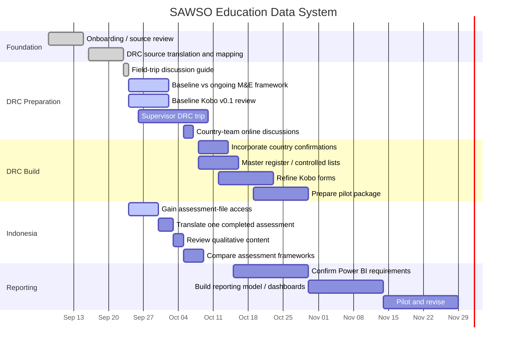

# Project Timeline

This timeline is a working planning view. Dates may change as country-team decisions, file access, and pilot scheduling become clearer.

## Current phase

The project is still in **pre-implementation / early build**. The immediate focus is to remove ambiguity from source data and reporting workflows before scaling form development.
