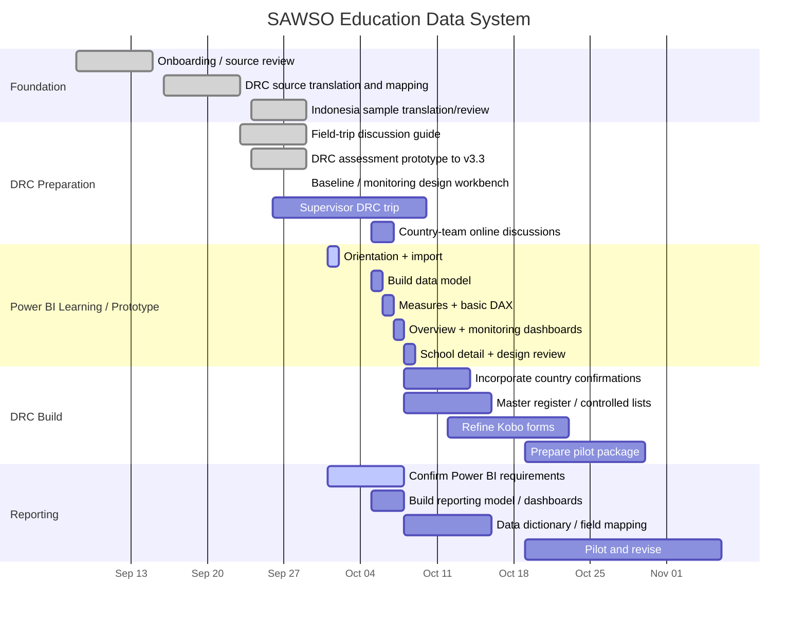

# Project Timeline

This timeline is a working planning view. Dates may change as country-team decisions, file access, and pilot scheduling become clearer.

## Current phase

The project is now in **early build and analytical prototyping**. Kobo has reached a stable working DRC assessment prototype (v3.3), while unresolved country-specific items remain explicit questions for Doug / DRC.

The immediate reporting focus is a staged Power BI learning sprint from **1–8 October** using synthetic data. The purpose is not just to learn dashboard software, but to test whether the current collection model supports useful management decisions before more fields are added to Kobo.

If DRC consultations take place during 5–7 October, those discussions take priority and unfinished Power BI tasks roll forward without compressing the learning sequence.
